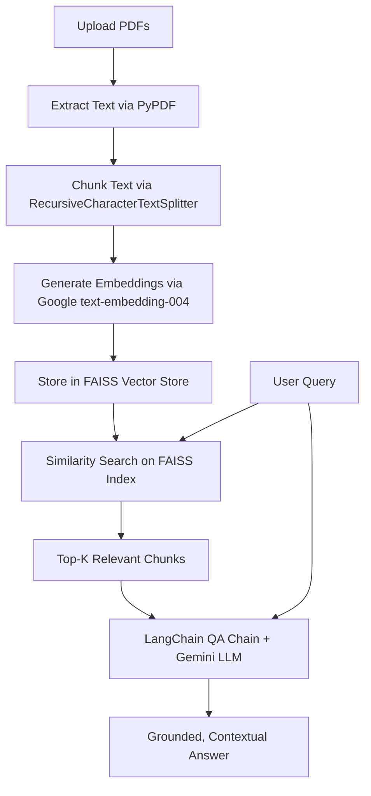

# Multi-PDF ChatBot with Google Gemini & FAISS

An intelligent, Retrieval-Augmented Generation (RAG) conversational AI application built with **Streamlit**, **LangChain**, and **Google Gemini (1.5 / 2.0 Flash & Pro)**. Upload multiple PDF files and ask questions to receive accurate, context-aware answers directly sourced from your documents.

---

## 🌟 Key Features

- **Multi-PDF Ingestion**: Upload multiple PDF documents simultaneously with automated text extraction and error recovery.
- **Intelligent Chunking**: Splits large documents into overlapping semantic chunks using LangChain's `RecursiveCharacterTextSplitter`.
- **Vector Search with FAISS**: Generates embeddings using Google's `text-embedding-004` and stores them in a local FAISS vector index for millisecond similarity retrieval.
- **Google Gemini Integration**: Supports state-of-the-art models (`gemini-1.5-flash`, `gemini-1.5-pro`, and `gemini-2.0-flash`).
- **Context-Preserving QA**: Employs an anti-hallucination QA prompt to ensure replies are grounded solely in the provided document context.
- **Context Transparency**: Expandable view showing the exact document chunks retrieved and used to generate the answer.
- **Interactive Streamlit UI**: User-friendly interface with sidebar API key input, model selection, index management, and clear-index controls.

---

## 🏗️ Architecture & Workflow



---

## 🚀 Quick Start

### 1. Prerequisites
- Python 3.10+ (tested on Python 3.10, 3.11, and 3.12)
- A Google Gemini API key ([Get a free key from Google AI Studio](https://aistudio.google.com/))

### 2. Clone the Repository
```bash
git clone https://github.com/aakashdeepgill/MultiPdfChatBot.git
cd MultiPdfChatBot
```

### 3. Set Up Environment & Install Dependencies

**Using `uv` (recommended, ultrafast):**
```bash
uv venv
source .venv/bin/activate
uv pip install -r requirements.txt
```

**Using standard `pip`:**
```bash
python3 -m venv .venv
source .venv/bin/activate
pip install -r requirements.txt
```

### 4. Configure Your API Key
Create a `.env` file from the provided template:
```bash
cp .env.example .env
```
Add your Gemini API key in `.env`:
```env
GOOGLE_API_KEY=your_gemini_api_key_here
```
*(Alternatively, you can enter the API key directly into the sidebar field in the web UI.)*

### 5. Launch the Application
```bash
streamlit run main.py
```
The application will open in your browser at `http://localhost:8501`.

---

## 📖 Usage Guide

1. **Enter API Key**: If not set via `.env`, input your Google API Key in the sidebar.
2. **Select Model**: Choose between `gemini-1.5-flash` (fast & cost-effective), `gemini-1.5-pro` (high reasoning), or `gemini-2.0-flash`.
3. **Upload Documents**: Select one or more PDF files via the file uploader in the sidebar.
4. **Process Documents**: Click **Submit & Process** to extract text, compute embeddings, and build the FAISS index.
5. **Ask Questions**: Type your prompt into the main input box and receive detailed, grounded responses with citations of retrieved chunks.

---

## 🛠️ Tech Stack

| Technology | Purpose |
|---|---|
| **Streamlit** | Interactive web application frontend |
| **LangChain** | Document processing, prompt chaining & orchestration |
| **Google Gemini API** | LLM text generation (`gemini-1.5-flash`, `gemini-1.5-pro`) |
| **Google GenerativeAI Embeddings** | Vector embeddings (`models/text-embedding-004`) |
| **FAISS** | Facebook AI Similarity Search vector database |
| **pypdf** | PDF document parsing and text extraction |
| **python-dotenv** | Environment variable management |

---

## 📄 License

This project is licensed under the [MIT License](LICENSE).
