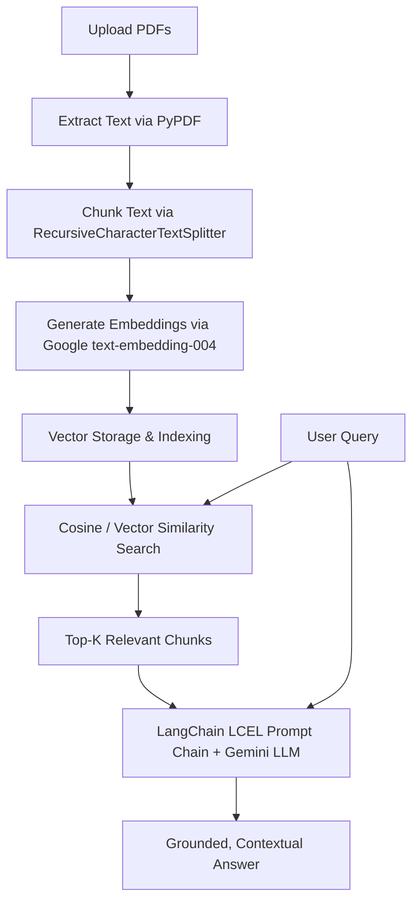

# Multi-PDF ChatBot with Google Gemini & LangChain

An intelligent, Retrieval-Augmented Generation (RAG) conversational AI application built with **Google Gemini (1.5 / 2.0 Flash & Pro)** and **LangChain**. Upload multiple PDF files and ask questions to receive accurate, context-aware answers directly sourced from your documents.

**Dual Deployment Ready**:
- 🌐 **Vercel Serverless**: Deploy with 1-click on Vercel with modern FastAPI backend and responsive HTML/Tailwind web app.
- 💻 **Streamlit Desktop/Local**: Run locally using Streamlit with local FAISS vector store.

---

## 🌟 Key Features

- **Multi-PDF Ingestion**: Upload multiple PDF documents simultaneously with automated text extraction and error recovery.
- **Intelligent Chunking**: Splits large documents into overlapping semantic chunks using LangChain's `RecursiveCharacterTextSplitter`.
- **High-Dimensional Vector Search**: Generates embeddings using Google's `text-embedding-004` and performs vector similarity search.
- **Google Gemini Integration**: Supports state-of-the-art models (`gemini-1.5-flash`, `gemini-1.5-pro`, and `gemini-2.0-flash`).
- **Context-Preserving QA**: Employs an anti-hallucination QA prompt to ensure replies are grounded solely in the provided document context.
- **Context Transparency**: Expandable view showing the exact document chunks retrieved and used to generate the answer.
- **Vercel Serverless Optimized**: Stateless, zero cold-start loss, works reliably without requiring external paid database setup.

---

## 🏗️ Architecture & Workflow



---

## ⚡ Deploy to Vercel

### Option 1: Deploy via Vercel Web Dashboard (Recommended)

1. Fork or push this repository to your GitHub account: `https://github.com/aakashdeepgill/MultiPdfChatBot`.
2. Go to [Vercel Dashboard](https://vercel.com/dashboard) and click **Add New...** -> **Project**.
3. Import your `MultiPdfChatBot` repository.
4. (Optional) In **Environment Variables**, add:
   - `GOOGLE_API_KEY`: `your_gemini_api_key_here`  
   *(Note: Users can also enter their API key directly in the web UI sidebar at runtime.)*
5. Click **Deploy**. Vercel will automatically build the serverless Python functions in `api/index.py` and serve the web frontend in `public/index.html`.

### Option 2: Deploy using Vercel CLI
```bash
npm i -g vercel
vercel
```

---

## 💻 Local Development

### 1. Prerequisites
- Python 3.10+ (tested on Python 3.10, 3.11, and 3.12)
- A Google Gemini API key ([Get a free key from Google AI Studio](https://aistudio.google.com/))

### 2. Clone the Repository
```bash
git clone https://github.com/aakashdeepgill/MultiPdfChatBot.git
cd MultiPdfChatBot
```

### 3. Set Up Environment & Install Dependencies

**Using `uv` (recommended, ultrafast):**
```bash
uv venv
source .venv/bin/activate
uv pip install -r requirements.txt
```

**Using standard `pip`:**
```bash
python3 -m venv .venv
source .venv/bin/activate
pip install -r requirements.txt
```

### 4. Configure Your API Key
Create a `.env` file from the provided template:
```bash
cp .env.example .env
```
Add your Gemini API key in `.env`:
```env
GOOGLE_API_KEY=your_gemini_api_key_here
```
*(Alternatively, you can enter the API key directly in the web UI sidebar.)*

### 5. Launch Locally

**Mode A: Run the Vercel-ready Web App (FastAPI + Modern Web UI)**
```bash
uvicorn api.index:app --reload --port 8000
```
Open [http://localhost:8000](http://localhost:8000) in your browser.

**Mode B: Run the Streamlit Application**
```bash
streamlit run main.py
```
Open [http://localhost:8501](http://localhost:8501) in your browser.

---

## 📖 Usage Guide

1. **Enter API Key**: If not set via `.env` or Vercel environment variables, input your Google API Key in the sidebar.
2. **Select Model**: Choose between `gemini-1.5-flash` (fast & cost-effective), `gemini-1.5-pro` (deep reasoning), or `gemini-2.0-flash`.
3. **Upload Documents**: Select one or more PDF files via the file uploader in the sidebar.
4. **Process Documents**: Click **Submit & Process** to extract text, compute embeddings, and build the vector index.
5. **Ask Questions**: Type your prompt into the main input box and receive detailed, grounded responses with citations of retrieved chunks.

---

## 🛠️ Tech Stack

| Technology | Purpose |
|---|---|
| **Vercel** | Serverless hosting & edge delivery |
| **FastAPI** | High-performance Python serverless API backend |
| **Streamlit** | Desktop/local interactive Python UI |
| **LangChain** | Document processing, prompt chaining & orchestration (LCEL) |
| **Google Gemini API** | LLM text generation (`gemini-1.5-flash`, `gemini-1.5-pro`, `gemini-2.0-flash`) |
| **Google GenerativeAI Embeddings** | Vector embeddings (`models/text-embedding-004`) |
| **FAISS & NumPy** | Vector similarity retrieval |
| **pypdf** | PDF document parsing and text extraction |
| **Tailwind CSS** | Responsive, modern UI styling |

---

## 📄 License

This project is licensed under the [MIT License](LICENSE).
